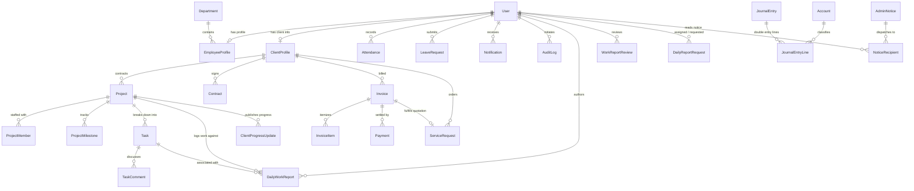

# I2S Business Management Website — Database Architecture & ER Diagram

## Overview
The **Imagination2Software (I2S)** database architecture is designed as a normalized, multi-tenant enterprise system supporting 8 specialized user roles, complete double-entry general ledger accounting, project and task tracking, daily work progress workflows, and secure client portal services.

---

## Entity Relationship (ER) Diagram

---

## Database Domains & Table Inventory

| Domain | Table Name | Purpose | Key Constraints & Indexes |
| :--- | :--- | :--- | :--- |
| **Authentication & Access** | `user` | Core user identity, login credentials, and approval status | `UNIQUE(email)`, `INDEX(role, approvalStatus)` |
| | `rolepermission` | Granular action overrides per system role | `UNIQUE(role, module, action)` |
| | `companysetting` | System-wide parameters and currency | `UNIQUE(key)` |
| **HR & Organization** | `department` | Functional company business units | `UNIQUE(name)` |
| | `employeeprofile` | Staff designation, salary, joining date | `UNIQUE(userId)`, `UNIQUE(employeeCode)` |
| | `attendance` | Biometric / web check-in & check-out | `UNIQUE(userId, date)`, `INDEX(date)` |
| | `leaverequest` | Leave applications and manager approvals | `INDEX(userId, status)` |
| | `leavebalance` | Annual accrued casual, sick & paid days | `UNIQUE(employeeProfileId, year)` |
| | `payslip` | Monthly gross-to-net salary slips | `UNIQUE(employeeProfileId, month, year)` |
| **Projects & Tasks** | `project` | Software project deliverables & budgets | `UNIQUE(code)`, `INDEX(clientId, status)` |
| | `projectmember` | Role assignment within project | `UNIQUE(projectId, userId)` |
| | `projectmilestone`| Target release dates & deliverables | `INDEX(projectId, targetDate)` |
| | `task` | Assigned tickets, sprints & reviews | `INDEX(projectId, status)` |
| | `taskcomment` | Threaded discussions & code links | `INDEX(taskId)` |
| **Daily Work Reports** | `dailyworkreport` | Daily intern/staff progress logs | `INDEX(authorId, reportDate)`, `INDEX(projectId)` |
| | `workreportreview` | Team Leader feedback & grading | `INDEX(reportId)` |
| | `dailyreportrequest`| Team Leader report submission notices | `INDEX(targetUserId, reportDate)` |
| | `clientprogressupdate`| Curated milestones published to Client | `INDEX(projectId, updateDate)` |
| **Finance & Invoicing** | `account` | Chart of Accounts (Assets, Liabilities, etc.) | `UNIQUE(code)` |
| | `invoice` | GST compliant corporate tax invoices | `UNIQUE(invoiceNumber)`, `INDEX(clientId, status)` |
| | `invoiceitem` | Quantities, unit rates, tax amounts | `INDEX(invoiceId)` |
| | `payment` | Bank transfers, receipts, settlements | `UNIQUE(receiptNumber)`, `INDEX(invoiceId)` |
| | `journalentry` | Double-entry transaction headers | `UNIQUE(entryNumber)` |
| | `journalentryline`| Debit & Credit allocations | `INDEX(journalEntryId, accountId)` |
| | `expense` | Operational expenditure records | `INDEX(category, expenseDate)` |
| **Client Portal** | `clientprofile` | Company name, GSTIN, primary contact | `UNIQUE(userId)`, `UNIQUE(companyName)` |
| | `contract` | Master services agreements | `INDEX(clientId)` |
| | `servicecatalog` | Available technical offerings & base rates | `INDEX(category, isActive)` |
| | `servicerequest` | Client order submissions & quotes | `UNIQUE(requestNumber)`, `INDEX(clientId, status)` |
| **Security & Audits** | `auditlog` | Immutable compliance tracking | `INDEX(userId, action)` |
| | `notification` | In-app alerts and notifications | `INDEX(userId, isRead)` |
| | `adminnotice` | Corporate broadcasts and announcements | `INDEX(senderId, priority)` |
| | `noticerecipient`| Multi-role broadcast delivery tracking | `UNIQUE(noticeId, userId)` |

---

## Technical Specifications

- **Target Engine**: MySQL 8.0+ / 5.7+ (InnoDB)
- **Character Encoding**: `utf8mb4`
- **Collation**: `utf8mb4_unicode_ci`
- **Primary Key Strategy**: UUID (v4) strings (36 chars)
- **Financial Numbers**: Exact fixed-point `DECIMAL(12, 2)` (no floating point arithmetic)
- **Timezone**: Strict UTC on storage, rendered in client local timezone (`Asia/Kolkata` default)
